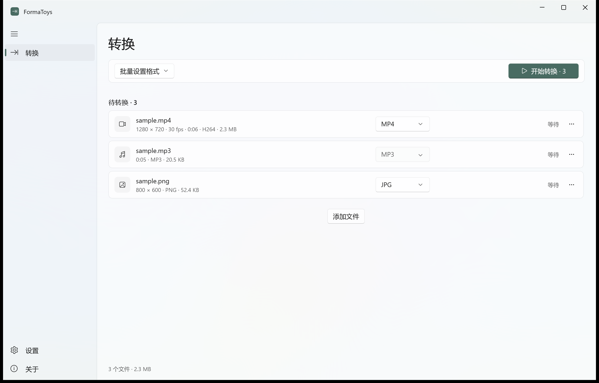
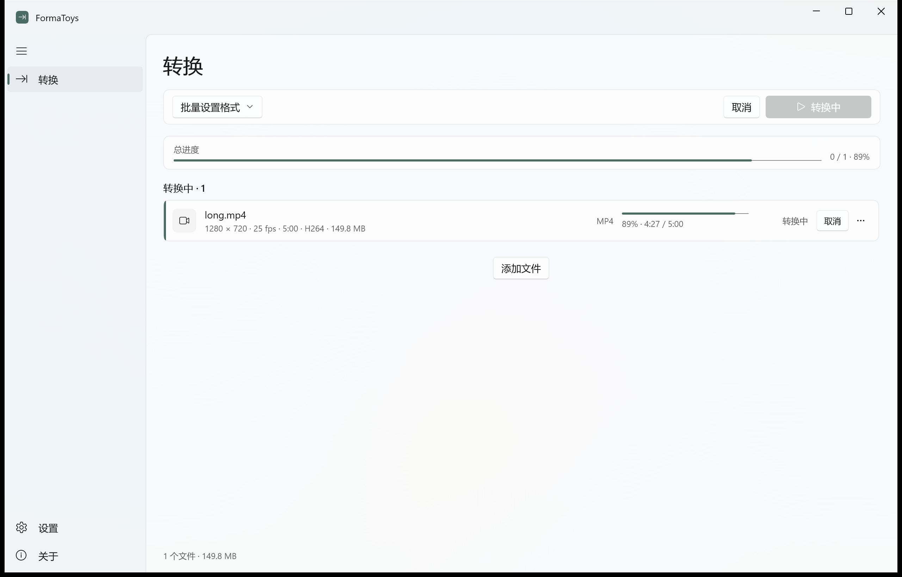
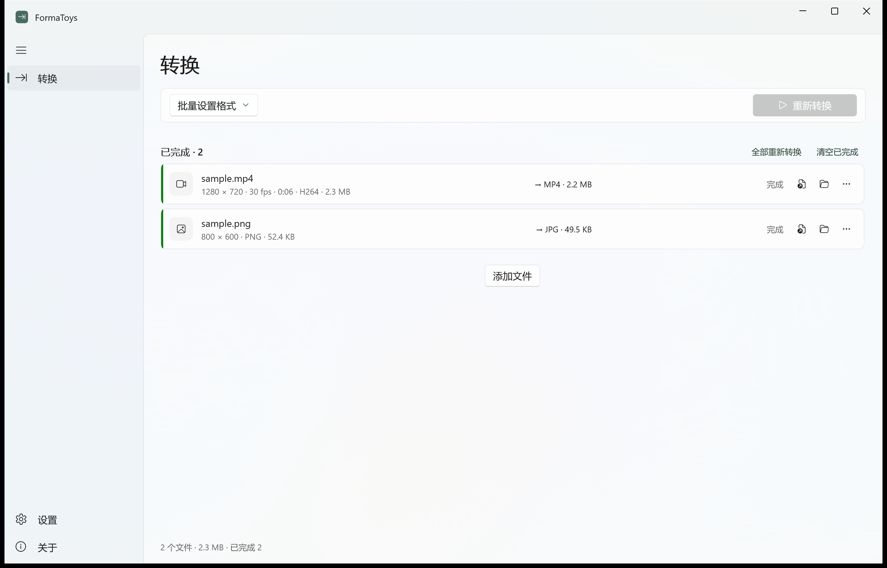
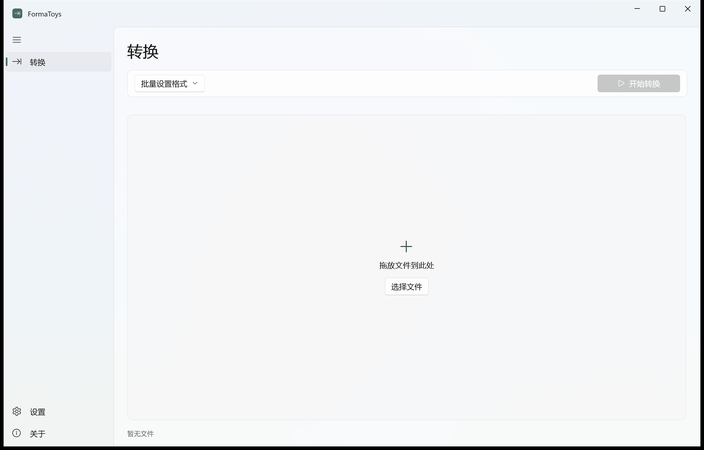
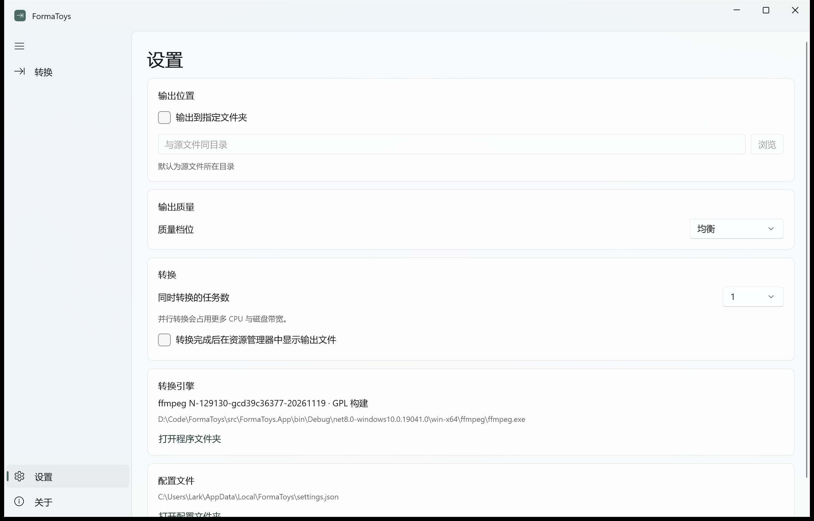
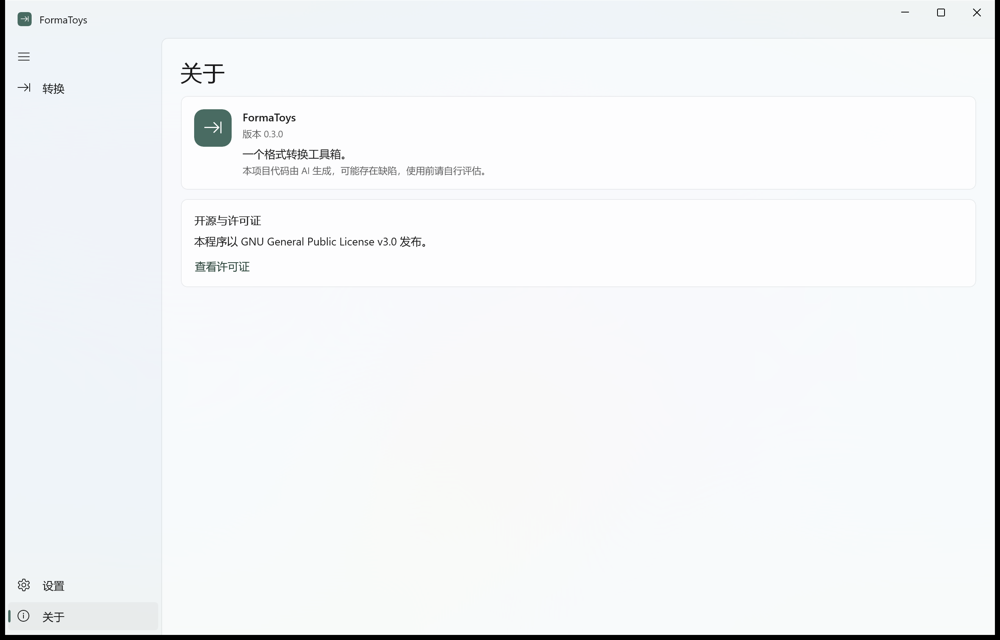

# FormaToys

Win11 独占的原生 ffmpeg 图形前端 —— “格式工厂”的现代重写版：**拖入文件，为每个文件选择目标格式，开始转换。**



- **原生**：WinUI 3 + Fluent（NavigationView 侧栏、Mica 背景、圆角卡片、系统强调色），无 WebView、Electron 或任何 web 技术栈。
- **快**：冷启动到窗口出现实测 376 ms（Release、发布版）；不缓存、不建库、不联网。
- **不臃肿**：5 个 XAML（应用、主窗口、转换页、设置页、关于页）+ 1 个文件行控件，Core 内 20 个源文件。
- **可用**：内嵌 GPL 版 ffmpeg（`ffmpeg.exe` + `ffprobe.exe`），13 种目标格式，真实进度（16 ms 采样）、可取消、失败给出原因。

## 界面

左侧为导航栏（转换 / 设置 / 关于），右侧内容按卡片分块。

| 待转换：每个文件自带格式 | 转换中：分段显示 + 真实进度 |
| --- | --- |
|  |  |

| 已完成：打开、定位、重新转换 | 空状态：整页接收拖放 |
| --- | --- |
|  |  |

| 设置：输出位置、质量、并发、引擎 | 关于 |
| --- | --- |
|  |  |

## 快速开始

下载：

- `FormaToys-<版本>-win-x64.exe` —— 单文件启动器，双击即用（首次运行解压到 `%LOCALAPPDATA%\FormaToys\app\`）。
- `FormaToys-<版本>-win-x64.zip` —— 便携版，解压后直接运行 `FormaToys.exe`。

从源码构建：

```powershell
# 1) 需要 .NET 8 运行时 + Windows App SDK（构建期由 NuGet 提供）
#    ffmpeg 已作为 Brotli 压缩的嵌入资源随仓库提供（assets\ffmpeg\*.br），
#    若需更新版本，按 docs\BUILD.md 重新生成。

# 2) 构建
dotnet build FormaToys.slnx -c Debug

# 3) 运行
.\src\FormaToys.App\bin\Debug\net8.0-windows10.0.19041.0\win-x64\FormaToys.exe

# 带文件启动
$exe = ".\src\FormaToys.App\bin\Debug\net8.0-windows10.0.19041.0\win-x64\FormaToys.exe"
& $exe .\clip.mp4 .\song.mp3 .\pic.png
```

打包发布物（便携 zip + 单文件 exe）：

```powershell
pwsh -NoProfile -File tools\package-release.ps1     # 输出 artifacts\release
```

## 使用方法

1. 将文件拖入窗口，或点击“选择文件 / 添加文件”。视频、音频、图片可混合导入，支持批量。
2. 文件列表按状态分为三段，空段不显示：
   - **待转换** —— 已导入、尚未转换；每行右侧的下拉框为该文件的目标格式（视频文件仅列出视频格式，音频仅列出音频格式）。
   - **转换中** —— 正在执行的任务，各自显示进度条（`11% · 0:04 / 0:40`）。
   - **已完成** —— 转换完成，行尾提供“打开”“在资源管理器中显示”，亦可重新转换或移除。
3. 批量指定格式：点击工具条的“批量设置格式”，选择“所有视频 → MP4”“所有音频 → MP3”等入口，
   对该类型的全部文件一次设置。
4. 输出质量在**设置 → 输出质量**中选择：文件小 / 均衡 / 高画质。内部映射到 CRF 或码率，界面不显示 CRF。
5. 输出默认写入**源文件所在目录**，重名自动追加序号；可在设置中改为固定目录，亦可在行尾“…”中为单个文件指定输出文件夹。
6. 点击“开始转换”。完成后按钮变为“重新转换”。批量转换时顶部显示总进度（`已完成 N / 总数 M · 百分比`）。

单个文件失败不影响其他任务：该行状态变为“失败”并显示 ffmpeg 的具体原因（悬停查看完整信息），左侧状态条转红。

## 当前功能（v0.3.0）

- **导航骨架**：NavigationView（转换 / 设置 / 关于），设置入口位于侧栏。
- **三段式工作区**：待转换 / 转换中 / 已完成，各段标题带计数，空段自动隐藏；无文件时仅显示拖放区。
- **格式跟随文件**：每行独立的目标格式选择器，同一列表中 mp4→WebM、mp3→FLAC、png→JPG 互不影响；另有按类型的批量设置入口。
- **真实进度**：读取 ffmpeg `-progress` 输出，16 ms 采样刷新；无法获取总时长时切换为不确定态进度条；批量转换时顶部显示总进度。
- **取消**：支持单个取消与整批取消，终止进程树，未完成的半成品立即删除。
- **输出规划**：全局输出目录 + 单文件覆盖，重名不覆盖。
- **设置持久化**：输出质量、输出位置、并发数（1–4）、完成后是否打开资源管理器、各类型上次使用的格式。
- **命令行带文件启动**；崩溃写入 `%LOCALAPPDATA%\FormaToys\crash.log`，队列异常写入 `queue.log`。

## 目录结构

```
FormaToys/
├─ FormaToys.slnx                 # SDK 10 的解决方案格式
├─ global.json                    # 锁定 .NET SDK 10.0.403
├─ Directory.Build.props          # 公共属性（LangVersion 12 / 版本号）
├─ LICENSE                         # GPL-3.0 全文（程序本体与内嵌 ffmpeg 同一许可证）
├─ assets/ffmpeg/                  # 内嵌 ffmpeg 资源（*.br 入库，原始 .exe 不入库）
│  ├─ ffmpeg.exe.br  ffprobe.exe.br   # Brotli 压缩的 GPL 构建，编译期嵌入 FormaToys.Core.dll
│  ├─ ffmpeg-version.txt              # 版本串，供运行期日志与缓存目录使用
│  └─ LICENSE.txt                     # ffmpeg 的 GPL 全文
├─ src/
│  ├─ FormaToys.Core/             # 与 UI 无关的内核，可被 CLI / 测试复用
│  │  ├─ Media/                   # MediaKind、QualityLevel、MediaInfo、MediaProbe、FormatCatalog
│  │  ├─ Conversion/              # ConversionRequest/Result、ConversionProgress、
│  │  │                           # FfmpegCommandBuilder、OutputPlanner、ProgressParser、
│  │  │                           # ConversionEngine（16 ms 采样上报进度）
│  │  ├─ Tooling/                 # ToolPaths（定位 ffmpeg）、EmbeddedTools（解压内嵌 ffmpeg）、
│  │  │                           # StartupCheck（版本/GPL 探测）
│  │  └─ Settings/                # AppSettings + SettingsStore（JSON 落盘）
│  └─ FormaToys.App/              # WinUI 3 前端
│     ├─ App.xaml(.cs)            # 应用入口、未处理异常兜底、命令行文件
│     ├─ MainWindow.xaml(.cs)     # 自定义标题栏 + NavigationView + 页面路由
│     ├─ Views/                   # ConvertPage / SettingsPage / AboutPage
│     ├─ Controls/FileRow.xaml    # 文件行：图标、源信息、格式选择器、进度、状态、操作
│     ├─ ViewModels/              # ConvertQueueViewModel（三段队列）、
│     │                           # FileItemViewModel（单行状态机）、DisplayFormat
│     ├─ Services/                # AppServices（依赖容器）、ShellService（打开/定位文件）
│     └─ Assets/app.ico
├─ tools/
│  ├─ FormaToys.Smoke/            # 无界面冒烟测试：生成样本 → 转 14 项 → ffprobe 校验
│  ├─ FormaToys.Setup/            # 单文件启动器：内嵌载荷，解压到 %LOCALAPPDATA% 后启动
│  ├─ pack-ffmpeg.ps1             # 把 ffmpeg / ffprobe 压成 Brotli 嵌入资源
│  ├─ package-release.ps1         # 出便携 zip + 单文件 exe
│  ├─ publish.ps1  make-icon.ps1
│  └─ capture.ps1  uia.ps1  verify-v02.ps1   # 截图 / UI 自动化 / 端到端验收
└─ docs/
   ├─ PLAN.md                     # 方案：定位、页面结构、交互规则、架构、参数表、路线图
   ├─ BUILD.md                    # 环境、ffmpeg 准备、构建、发布、踩过的坑
   └─ THIRD-PARTY-NOTICES.md      # ffmpeg 的 GPL 说明
```

## 自检

```powershell
dotnet build FormaToys.slnx -c Debug                                     # 0 警告 0 错误
dotnet run --project tools\FormaToys.Smoke\FormaToys.Smoke.csproj -c Release
# 现场生成样本 → 转 14 个格式用例 → ffprobe 校验 → 退出码 0 表示全绿
```

## 体积与内存

| 指标 | 实测 |
| --- | --- |
| 发布目录 | 466 MB（325 个文件） |
| 其中 ffmpeg + ffprobe | 各约 165 MB（BtbN GPL 静态构建） |
| 程序自身（exe + dll + xbf） | 约 4 MB |
| 冷启动到窗口出现 | 376 ms（v0.2 三次实测中位数） |
| 空态工作集 / 私有内存 | 133 MB / 92 MB |

后续将改用裁剪过的 ffmpeg 构建（仅保留常用编解码器），将整包压缩到 100 MB 以内。

## 路线图

- **M1**：单机批量格式转换 + 质量三档 + 进度/取消 + 设置持久化（v0.1）
- **M2**：PowerToys 式导航骨架、三段队列、每文件独立格式 + 按类型批量设置、16 ms 真实进度、单文件输出覆盖（v0.2）
- **M3（当前）**：界面精简与文案规范化、质量档位移入设置（v0.3）
- **M4**：裁剪版 ffmpeg（整包 < 100 MB）、单实例 + 任务栏图标接收文件、剪裁/旋转/去音轨、目标大小模式（两遍编码）、硬件编码（NVENC/QSV/AMF）探测
- **明确不做**：账号与云同步、广告、捆绑安装器、视频剪辑时间线、CD/DVD 抓取

## 许可证

本项目以 **GNU General Public License v3.0** 发布，全文见 [LICENSE](LICENSE)。内嵌的 ffmpeg 同为 GPL v3 构建，
通过独立进程调用；分发包含 ffmpeg 二进制的整包时，需同时提供相应源码或获取方式，详见
[docs/THIRD-PARTY-NOTICES.md](docs/THIRD-PARTY-NOTICES.md)。
